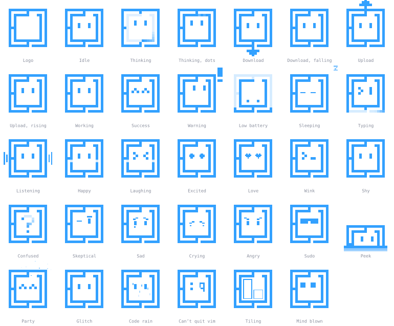

# Omi - The Omarchy logo, brought to life.

Omi is the Omarchy mascot: the Omarchy logo with a face. It has modes
from idle and thinking to download, success and party, morphs from any one
to any other, and is drawn as plain rectangles in one color, so any app can
show it: a shell plugin, a web page, a Qt app, a terminal, a Rust or a
Python program.

## What Omi is for

Omarchy is a system that talks to its user: notices at first boot, updates,
agents that work on their behalf. Omi gives those moments one face. An app
sets what Omi is doing (`thinking` while it checks, `download` while it
installs, `listening` while it waits for a key) and reacts to what just
happened (`success`, `love`), and because every app uses the same
modes for the same situations, Omi means the same thing everywhere.

The rules it's drawn by, in short (the long form is in
[docs/designing.md](docs/designing.md)):

- **It is the logo.** Every mode is the Omarchy logo's own rectangles, with
  a face inside, props around, or the frame itself bending.
- **One color.** Omi takes the host's accent. Meaning comes from shape and
  motion, never from a second color.
- **Pixel art.** Everything sits on the logo's 20-unit grid, so Omi stays
  crisp at any size and morphs cleanly between modes.
- **Eyes, not mouths.** Omi reads through its eyes, brows and props.
- **Never guilt the user.** Modes are for what the system is doing and
  what just happened, not for scolding.
- **Calm by default.** States are something the eye can rest on;
  reactions are quick and go back by themselves.

[docs/modes.md](docs/modes.md) shows every mode with what it's for.

- **The site:** [index.html](index.html), the home page that shows Omi
  off, and [jig.html](jig.html), the design jig, where every mode is looked
  at, restyled with the Controls, and exported as a picture or a video.
  `npm run dev` serves both at http://localhost:8000 and reloads them as you
  edit; the site, https://tahayvr.github.io/omi/, is the same pages,
  published from `master` once its checks pass
  ([.github/workflows/publish.yml](.github/workflows/publish.yml)). What they
  show is the kit, played by the player: add `?check` to the jig's address
  and it checks that itself.
- **[kit/](kit/):** what apps use: `omi.json` (every mode, with what a
  screen reader says for each), `omi.js` (the player), the spec and a JSON
  Schema. It's released as packages, each with the kit inside:
  `npm install omi-kit`, `pip install omi-kit`, `cargo add omi`
  ([CHANGELOG.md](CHANGELOG.md)).
- **[player/rust/](player/rust/) and [player/python/](player/python/):**
  two more players, a Rust crate and a Python package, written from the
  spec and checked against the same conformance data. They draw every morph
  as the reference player does, rect for rect.
- **[examples/](examples/):** Omi in an Omarchy shell plugin, a web page, a Qt
  Quick app, a terminal (Node, or nothing but bash, jq and awk, with a
  bashrc that makes the shared Omi follow your shell), and desktop windows
  in Python and in Rust with their players.
- **[docs/omarchy.md](docs/omarchy.md):** building Omi into Omarchy, and which
  mode to show when.
- **[docs/modes.md](docs/modes.md):** every mode, with a still and what it's
  for. **[docs/designing.md](docs/designing.md):** the rules Omi is drawn
  by, and how a mode goes from the jig to the kit.
- **[protocol/](protocol/) and [service/](service/):** one Omi shared by
  every app on the machine.
- **[docs/ideas.md](docs/ideas.md):** modes and reactions still to make, each
  with a sketch.

Checks: `npm run check` runs the ones that only need Node: that kit/ and
docs/modes are built from what's committed (`tools/build-kit.js --check`,
`tools/modes-doc.js --check`), that the kit has its shape and keeps the
rules Omi is drawn by (`tools/check-kit.js`), the reference player
(`tools/check-player.js`) and the service (`tools/check-service.js`). Then `npm run check:site` (the
site, in Chrome: it shows the kit in kit/, and its CSS draws what the
player draws), `npm run check:rust` and `npm run check:python` (the Rust
and the Python player, on the conformance data), `npm run check:morphs`
(both of them against the reference player on every morph there is),
`npm run check:qt` (the Qt Quick example's item), `npm run check:bash` (the
bash example's player, on the conformance data) and, in a Wayland session,
`npm run check:quickshell`.
`npm run build` rebuilds kit/ and docs/modes. All but the site's, the
examples' and the Quickshell one run on every push
([.github/workflows/check.yml](.github/workflows/check.yml)); those are run
by hand. `just check` runs every one of them, formatting and lint
included, and `just quick` only what needs nothing but Node.

None of that needs anything installed. `pnpm install` brings in the two
tools the code is kept tidy with: `pnpm fmt` formats it (oxfmt) and
`pnpm lint` looks for mistakes (oxlint); both run on every push too.

## License

The code is MIT licensed. The Omi design is not: it is a derivative of the
Omarchy logo, owned by the Omacom Foundation, and the MIT license does not
apply to it. See [LICENSE](LICENSE).
